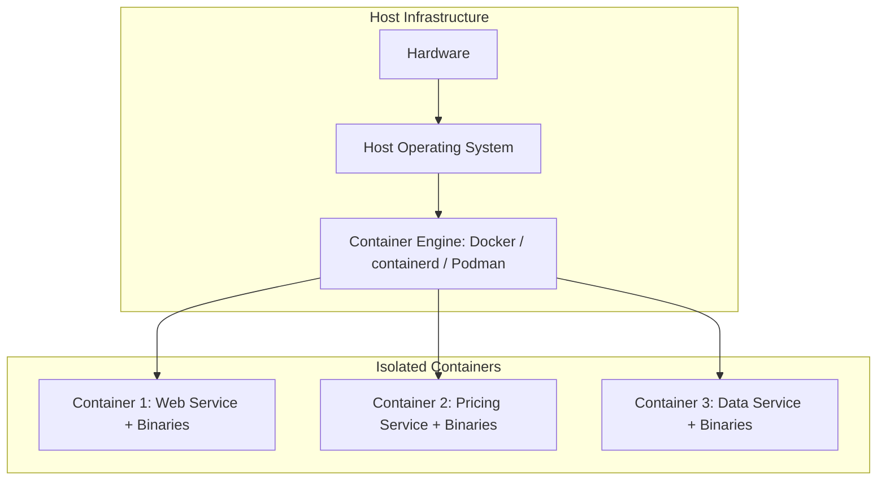

### **1. Introduction to Containerization & Architecture**
Containerization is a software deployment method that packages application code along with all its necessary files, libraries, and dependencies into a single, lightweight, and isolated unit called a container.

#### **Architecture Components**
*   **Hardware:** The physical or virtual machine infrastructure.
*   **Host OS:** The underlying host operating system.
*   **Container Engine:** Sits on top of the Host OS to manage and run containers.
*   **Containers:** Individual isolated environments running specific microservices or applications (e.g., Web Service, Pricing Service, Data Service) alongside their required binaries.

#### **Mermaid Diagram: Containerization Architecture**


#### **Advantages of Containerization**
1.  **Lightweight:** No full guest OS required; uses less RAM and CPU.
2.  **Fast Startup:** Containers boot in seconds.
3.  **Resource Sharing:** Multiple containers share host kernel resources efficiently.
4.  **Better Resource Usage & Portability:** Applications run consistently across environments.
5.  **Isolation & Scaling:** Keeps applications isolated and allows easy scaling.
6.  **DevOps & CI/CD Friendly:** Ideal for continuous integration and delivery pipelines.

#### **Popular Containerization Engines**
*   **containerd**
*   **Podman**
*   **CRI-O**
*   **Docker:** The most popular engine due to its ease of use, fast deployment, massive ecosystem, and integration with DevOps tools.

---

### **2. Docker Concepts: Image vs. Container**
*   **Docker Image:** A ready-made package/template containing application files, libraries, dependencies, and configuration settings required to run an application.
*   **Docker Container:** A running instance instantiated from a Docker image (e.g., a running Apache web server or Hello World container).

---

### **3. Step-by-Step Installation of Docker on Ubuntu**

#### **Step 1: Set Up Docker's Apt Repository & Keys**  

####  Do this step from google - Docker installation on Ubuntu

```bash
# 1. Update system package index
sudo apt update

# 2. Install prerequisites
sudo apt install ca-certificates curl -y

# 3. Create directory for keyring permissions
sudo install -m 0755 -d /etc/apt/keyrings

# 4. Download Docker's official GPG key
sudo curl -fsSL [suspicious link removed] -o /etc/apt/keyrings/docker.asc
sudo chmod a+r /etc/apt/keyrings/docker.asc

# 5. Add the repository to Apt sources
sudo tee /etc/apt/sources.list.d/docker.sources <<EOF
Types: deb
URIs: [suspicious link removed]
Suites: $(. /etc/os-release && echo "$UBUNTU_CODENAME")
Components: stable
Architectures: $(dpkg --print-architecture)
Signed-By: /etc/apt/keyrings/docker.asc
EOF
```
**

#### **Step 2: Install Docker Engine and Dependencies**
```bash
# 1. Update apt repository list
sudo apt update

# 2. Install Docker components
sudo apt install docker-ce docker-ce-cli containerd.io docker-buildx-plugin docker-compose-plugin -y
```
**

#### **Step 3: Service Management & Verification**
```bash
# Start and verify Docker daemon service
sudo systemctl start docker
sudo systemctl status docker

# Test installation with hello-world image
sudo docker run hello-world
```
**

---

### **4. Step-by-Step Docker Commands & Lifecycle Operations**

#### **A. Pulling & Inspecting Images**
```bash
# Download images from Docker Hub
docker pull ubuntu
docker pull nginx
docker pull apache2

# List local Docker images
docker images
```
**

#### **B. Running Containers**
*   **Interactive Mode (`-it`):** Attaches your terminal directly to the container's shell.
    ```bash
    docker run -it ubuntu /bin/bash
    ```
*   **Detached Background Mode (`-d` / `-itd`):** Runs the container silently in the background.
    ```bash
    docker run -d ubuntu
    docker run -itd ubuntu
    ```

#### **C. Exiting vs. Detaching**
*   **To exit and stop container:** Type `exit` inside the container terminal.
*   **To detach without stopping:** Press **`Ctrl + P`**, then **`Ctrl + Q`**.

#### **D. Listing Active & Inactive Containers**
```bash
# View running containers only
docker ps
# or
docker container ls

# View all containers (running + stopped)
docker ps -a
# or
docker container ls -a
```
**

#### **E. Managing Container States**
```bash
# Stop a running container
docker stop <container_id_or_name>

# Start a stopped container
docker start <container_id_or_name>

# Restart a container
docker restart <container_id_or_name>

# Remove a stopped container
docker rm <container_id_or_name>

# Forcefully remove a running container
docker rm -f <container_id_or_name>

# Remove multiple containers at once
docker rm <id1> <id2> <id3>
```
**

#### **F. Accessing Running Containers (`docker exec`)**
To attach a shell session to an already running background container:
```bash
docker exec -it <container_id_or_name> /bin/bash
```
**

---

### **5. Practical Lab: Hosting a Web Server Inside an Apache Container**

This step-by-step workflow demonstrates how to deploy and test an Apache web application inside a container.

#### **Step 1: Launch a detached container**
```bash
docker run -itd ubuntu
```
**

#### **Step 2: Enter the running container**
```bash
docker exec -it <container_id> /bin/bash
```
**

#### **Step 3: Update packages & install Apache2 inside container**
```bash
apt update -y
apt install apache2 -y
```
**

#### **Step 4: Create a custom web page**
```bash
cd /var/www/html
echo "welcome to my first container" > index.html
cat index.html
```
**

#### **Step 5: Start the Apache Web Service**
```bash
service apache2 status
service apache2 start
service apache2 status
```
**

#### **Step 6: Inspect IP Address & Test via `curl`**
Exit the container terminal back to the host machine:
```bash
# Inspect container metadata to obtain the IP address (e.g., 172.17.0.2)
docker inspect <container_id>

# Send HTTP request to verify web page deployment
curl http://<container_ip>
# Expected Output: welcome to my first container
```
**

---

### **6. Quick Reference Command Summary Table**

| Category | Command | Description | Source |
| :--- | :--- | :--- | :--- |
| **System Info** | `docker info` | Displays overall Docker system configuration. | |
| **Image Pull** | `docker pull <image>` | Downloads an image from Docker Hub. | |
| **List Images** | `docker images` | Displays local downloaded images. | |
| **Interactive Run**| `docker run -it <image>` | Launches container interactively. | |
| **Background Run**| `docker run -itd <image>` | Launches container in background. | |
| **List Running** | `docker ps` | Lists active containers. | |
| **List All** | `docker ps -a` | Lists all active and stopped containers. | |
| **Stop** | `docker stop <id>` | Gracefully stops a running container. | |
| **Start** | `docker start <id>` | Boots up a stopped container. | |
| **Restart** | `docker restart <id>` | Restarts a container instance. | |
| **Remove** | `docker rm <id>` | Deletes a stopped container. | |
| **Force Remove** | `docker rm -f <id>` | Forces deletion of a running container. | |
| **Execute Shell** | `docker exec -it <id> bash` | Opens a new bash shell in a running container. | |
| **Inspect Details**| `docker inspect <id>` | Shows detailed JSON configuration & IP addresses. | |

---
