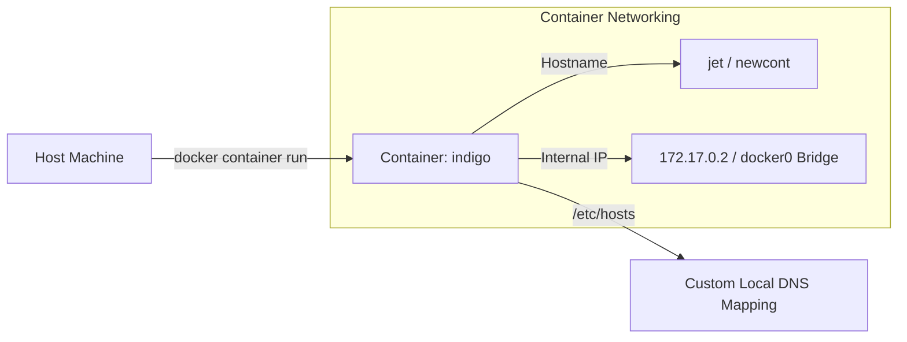
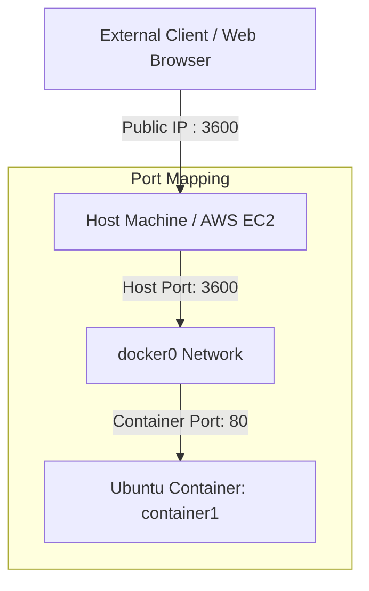
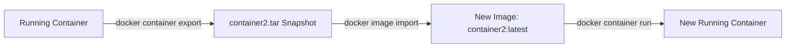

### **1. Container Naming, Hostnames, & Local DNS Resolution**

When launching containers, you can explicitly define their **container name** and internal **hostname** for easier identification and internal communication.



#### **Step-by-Step Commands:**
1. **Launch a container with a custom name and hostname**:
   ```bash
   docker container run -it --name indigo --hostname jet ubuntu
   ```
   *This creates a container named `indigo` with the internal hostname `jet`.*

2. **Verify container IP and configure local DNS inside container**:
   ```bash
   # Check internal container IP (e.g., 172.17.0.2)
   ifconfig
   
   # Add a local DNS mapping inside /etc/hosts
   vi /etc/hosts
   ```
   Add the following entry to map the IP address to the custom hostname:
   ```text
   172.17.0.2    indigo
   ```
   *(This allows pinging and communicating via `indigo` instead of raw IP addresses).*

3. **Install and run Nginx web server inside the container**:
   ```bash
   apt-get update -y
   apt-get install nginx -y
   cd /var/www/html/
   echo "welcome to skillops gang" > index.nginx-debian.html
   service nginx start
   ```
   *(Initializes the Nginx web server inside the container).*

---

### **2. Port Binding (`-p`) & AWS Security Group Configuration**

By default, container ports are isolated within the internal `docker0` bridge network and cannot be accessed from outside the host machine. **Port Binding** maps a port on the **Host Machine** to a port inside the **Container**.

#### **Port Binding Architecture Diagram**


#### **Step-by-Step Commands & Workflow:**

1. **Launch a container with explicit port binding**:
   ```bash
   docker container run -it --name container1 --hostname newcont -p 3600:80 ubuntu
   ```
   *Syntax:* `docker run -p <hostport>:<containerport> <image>`.
   *(Maps host port `3600` to container web port `80`).*

2. **Configure AWS EC2 Inbound Security Group Rules (for Cloud Deployments)**:
   * Navigate to **AWS Console** > **EC2** > **Security Groups**.
   * Click **Edit inbound rules**.
   * Add a new rule:
     * **Type:** Custom TCP
     * **Port range:** `3600`
     * **Source:** `0.0.0.0/0` (Anywhere-IPv4).
   * Click **Save rules**.

3. **Verify external web access**:
   Open a browser and navigate to:
   ```text
   http://<EC2_Public_IP>:3600
   ```
   *(The page displays the web page served directly from inside the container).*

---

### **3. Container Archiving: Export & Import Workflow**

Instead of using `docker commit` to build an image, you can export a container's entire filesystem into a `.tar` archive for backup or transfer across systems, and then import it back as a new Docker image.



#### **Step-by-Step Commands:**

1. **Export a running container to a tar archive**:
   ```bash
   docker container export container2 -o container2.tar
   ls
   ```
   *(Generates a snapshot file named `container2.tar` on the host machine).*

2. **Stop and remove the original container**:
   ```bash
   docker container stop container2
   docker container rm container2
   ```
   *(Cleans up the existing container instance).*

3. **Import the tar archive as a new Docker image**:
   ```bash
   docker image import container2.tar container2:latest
   docker images
   ```
   *(Creates a new local image named `container2:latest`).*

4. **Launch a new container from the imported image**:
   ```bash
   docker container run -itd --name container2 -p 8000:80 --hostname webserver container2:latest /bin/bash
   ```
   *Note: Imported images require an explicit command execution path like `/bin/bash` when starting.*

---

### **4. Container Inspection & Log Management**

To inspect container metadata or view runtime stdout/stderr output:

```bash
# Display standard container logs
docker logs <container_id_or_name>

# Stream live container logs continuously (-f / follow mode)
docker logs -f <container_id_or_name>

# Inspect internal network details, IP addresses, and gateway
docker inspect <container_name>
```
*(Displays real-time logs and detailed JSON network configurations).*

---

### **5. Database Container Setup & Docker Compose**

Database applications like **MongoDB** require runtime environment variables (`-e`) for root administrative credentials and initial configuration.

#### **A. Direct CLI Execution for MongoDB**:
```bash
docker run -d \
  -p 27017:27017 \
  -e MONGO_INITDB_ROOT_USERNAME=admin \
  -e MONGO_INITDB_ROOT_PASSWORD=.redhat \
  --name mongo \
  mongo
```
*(Starts MongoDB with port mapping `27017:27017` and root credentials).*

#### **B. Docker Compose Deployment (`file.yaml`)**:
Instead of long CLI parameters, define the configuration inside a custom YAML file:

```yaml
version: "3.8"

services:
  mongo:
    image: mongo
    ports:
      - "27017:27017"
    environment:
      MONGO_INITDB_ROOT_USERNAME: admin
      MONGO_INITDB_ROOT_PASSWORD: .redhat
```

**Execute Compose using a custom file name**:
```bash
docker compose -f file.yaml up -d
```
*(Deploys the MongoDB container in detached mode using the custom file `file.yaml`).*

---

### **6. Comprehensive Command Quick Reference**

| Task | Command | Description | Source |
| :--- | :--- | :--- | :--- |
| **Run with Hostname** | `docker container run -it --name <name> --hostname <host> <image>` | Assigns custom name and internal hostname. | |
| **Port Binding** | `docker run -p <host_port>:<container_port> <image>` | Binds host port to container port. | |
| **Export Container** | `docker container export <container> -o <file.tar>` | Exports container filesystem to tar archive. | |
| **Import Image** | `docker image import <file.tar> <image_name:tag>` | Creates a Docker image from tar archive. | |
| **View Logs** | `docker logs <container_id>` | Prints container console logs. | |
| **Follow Logs** | `docker logs -f <container_id>` | Continuously streams live logs. | |
| **Run with Env Vars**| `docker run -e KEY=VALUE <image>` | Passes environment variables to container. | |
| **Compose Custom File**| `docker compose -f <filename.yaml> up -d` | Launches compose stack using custom file. | |
